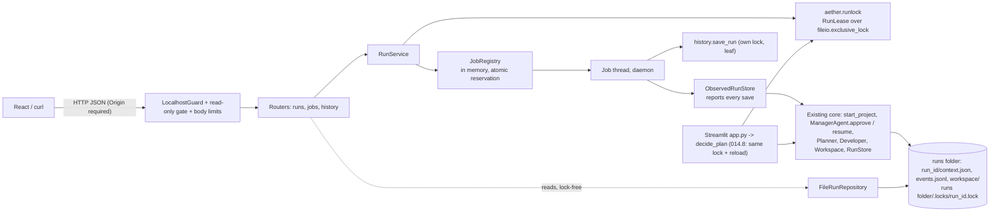
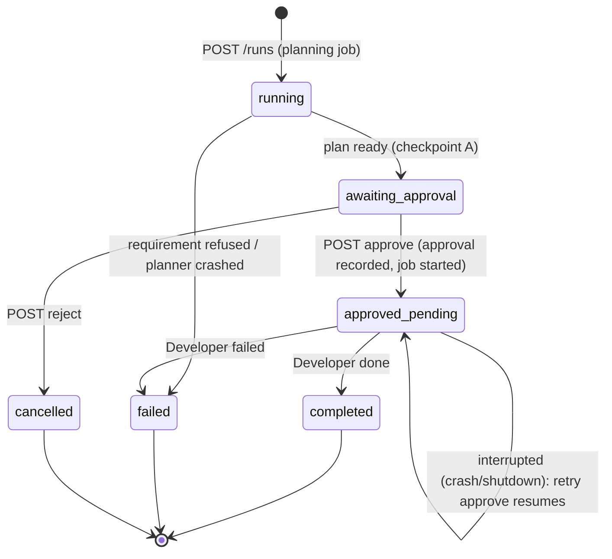

# Phase 3: write architecture for the AETHER API (Task 014.1, revision 2)

Status: ARCHITECTURE APPROVED IN PRINCIPLE (owner, 2026-11-26) with the clarifications of this revision. Nothing is implemented.
Base: commit `20c4cea` (Task 013), branch `main`. Every claim in section 2 was verified in the source.

Goal: let the FastAPI backend run AETHER's workflow (requirement, Manager, Planner, Checkpoint A, user decision, Developer,
generated files) while Streamlit keeps working, the core is reused without duplication, the Phase 2 read-only contracts stay
backward-compatible, and concurrent use of Streamlit and the API is safe.

---------------------------------------------------------------------------------------------------

## 0. What changed in revision 2

| # | Clarification requested | Where |
|---|---|---|
| 1 | Job reliability: shutdown, interrupted jobs, restart, concurrency limits under simultaneous requests | 6 |
| 2 | Approval: record the approval safely in the request, start the Developer as a background job, return the updated run AND the job id; rejection is separate | 5, 8.4, 8.5 |
| 3 | Per-run locking: acquisition timeout vs hold duration, whole transition, release on exceptions and process death, lock order, nothing global during AI work | 7 |
| 4 | Security: exact `--read-only` behaviour per endpoint; Host/Origin kept; tests for simultaneous and duplicate submissions; no token | 8.7, 9 |
| 5 | Streamlit compatibility (task 014.8) is REQUIRED before the write-enabled app is declared safe for concurrent use | 10, 14 |
| 6 | Unambiguous schemas, status codes, error codes and job transitions | 8 |
| 7 | Run identification: compare `ObservedRunStore` with an additive core parameter, recommend, add a protective test | 4 |

Corrections to revision 1 found while verifying (all by reading `aether/manager.py`):
- `resume()` sets `context.status = RUNNING` in memory only and saves nothing until the Developer returns. While the Developer
  runs, DISK shows `awaiting_approval` plus the recorded approval (not `running`). A crash then leaves exactly that state, which is
  resumable. Revision 1 said "the run stays running"; that was wrong.
- The planning job no longer holds the run lock (see 7.2): nobody else can legitimately write a run that is still planning.
- The shared run-lock helper moves from `aether_api` to a small stdlib-only core module, because Streamlit must use it too and
  `aether_ui` must never depend on `aether_api` (which needs FastAPI).

---------------------------------------------------------------------------------------------------

## 1. Summary of the design

| Topic | Decision |
|---|---|
| Starting a run | `POST /api/v1/runs` returns `202` with `run_id` and `job_id`; planning runs in a background job. |
| Early `run_id` (no core change) | `ObservedRunStore`, a `RunStore` subclass in `aether_api`, reports every save. The Manager saves the run right after "Understand requirement", BEFORE the planner runs. A contract test pins that order (section 4). |
| Jobs | In-memory, bounded, no queue, one daemon thread per job, at most 2 jobs (1 Ollama job); admission is one atomic reservation, so limits cannot be exceeded. Terminal states are immutable; an interrupted job can never look successful. |
| Approval | `POST /runs/{id}/approve`: under the run lock the request validates, RECORDS the approval, hands the lock to a background job that runs the Developer, and returns `202` with the updated run and the job id. |
| Rejection | `POST /runs/{id}/reject`: synchronous `200` (it only records and cancels; no job). |
| Locking | `aether/runlock.py` (new, stdlib-only, shared by API and Streamlit) over `aether.fileio.exclusive_lock`, file `<runs folder>/.locks/<run_id>.lock`. Writers only; reads stay lock-free. |
| Streamlit | Task 014.8 is required: Streamlit's `decide_plan` takes the same lock and reloads the run before deciding. It runs right after 014.3, before any write endpoint exists. |
| Security | Host/Origin guard kept; `--read-only` answers `405 writes_disabled` before anything is parsed or created; JSON-only, size cap, optional `Idempotency-Key`; no per-launch token (as approved). |
| Not used | Redis, Celery, SQLite, `ThreadPoolExecutor`, job persistence, job cancellation. |

Approved decisions kept: FastAPI in `aether_api/`, port 8765, background jobs with polling, Host/Origin validation with localhost
binding and no token, Streamlit stays operational, no SQLite, no Redis or Celery, bounded execution, Python 3.10+.

---------------------------------------------------------------------------------------------------

## 2. Verified findings about the existing architecture

| # | Finding (source) | Consequence |
|---|---|---|
| A1 | `start_project(requirement, planner=None, store=None) -> (RunResult, ProjectContext)` assembles `TracingPlanner`, `ManagerAgent`, `[PlannerAgent] + [DeveloperAgent(store)]` and calls `run_pipeline` (`aether_ui/workflow.py`). | The planning job calls it unchanged. |
| A2 | `run_pipeline(requirement, agents, store=None)` creates the context itself and saves it right after "Understand requirement" (or in `_finish` when the requirement is refused), before any agent runs; its docstring says "With a store, the context is saved after every step". It pauses before the Developer (checkpoint `"A"`, status `awaiting_approval`). | The run id exists before the up-to-5-minute planner call; every later save is a progress signal. |
| A3 | `ManagerAgent.approve(context, checkpoint, approved, note="", store=None, choice="")` raises `ValueError("This run is not waiting for approval.")` unless `awaiting_approval`, appends an `Approval`, records an event, saves, and sets `cancelled` on rejection. `resume(context, agents, store=None)`: for `cancelled` records skipped agents and saves; otherwise raises unless `awaiting_approval`, sets `running` IN MEMORY, runs the agents; the next save happens only after the Developer returns. | Approve and resume are separable public calls. While the Developer runs, disk = `awaiting_approval` + approval recorded. |
| A4 | `decide_plan(context, approved, store, note="", override="")` = `approve(...)` then `resume(context, project_agents(store), store)`. It has 3 callers in `app.py` (approve, reject, override); tests call it only on contexts saved by `start_project`. | 014.8 can add locking and a reload without changing its signature or the tested paths. |
| A5 | The Developer writes only through `Workspace` (path rules, suffix list, 100 kB per file, 50 files) and never calls an AI model. `Workspace.__init__` creates its folder. | Developer execution needs no new file code and holds no AI work. |
| A6 | With no matching template the Developer records a failure; Streamlit prevents it by disabling Approve (`app.py`), and an existing test pins the recorded failure. | The API enforces the guard itself (422); `decide_plan` keeps its behaviour. |
| A7 | `RunStore` saves atomically (Task 013) with no lock; `list_runs()` lists folders containing `context.json`. | Writers need a lock outside `RunStore`; a `.locks` folder is invisible to `list_runs`. |
| A8 | `aether/fileio.exclusive_lock(lock_path, timeout=None)`: thread lock plus OS lock, released by the OS if the holder dies; `history.save_run` / `clear_history` run under `history.json.lock` and are leaf operations. | Same primitive for runs; the history lock stays a leaf. |
| A9 | Streamlit decides on the context held in `st.session_state`: no reload, no lock. | A Streamlit tab and an API call can race on one run until 014.8. |
| A10 | `TracingPlanner` hides `fallback_reason` from `PlannerAgent` (K41); `RunResult.fallback_reason` has it. | The planning job reads it from the `RunResult`. |
| A11 | Phase 2: `LocalhostGuard` answers 405 to every non-GET; models are additive-friendly. Tests that encode the read-only surface (`test_api_contract`, `test_api_security`, `test_api_errors`, `test_api_basic`) must change deliberately and visibly. | Each such change is a reviewed update in task 014.4/014.5. |

---------------------------------------------------------------------------------------------------

## 3. Architecture overview



New modules:

| Module | Layer | Responsibility |
|---|---|---|
| `aether/runlock.py` | core, additive, stdlib-only | `acquire_run_lock(store, run_id, timeout) -> RunLease`, `RunLease.release()` (idempotent, usable from another thread), `RunLockBusy(OSError)`, lock path under `<runs folder>/.locks/`. Used by API AND Streamlit. |
| `aether_api/jobs.py` | API | `Job`, `JobRegistry` (atomic reservation, terminal-state CAS, TTL purge, idempotency keys, shutdown), worker start. |
| `aether_api/observed_store.py` | API | `ObservedRunStore(RunStore)`: calls `super().save()` then an observer; the observer never breaks a save. |
| `aether_api/services.py` | API | `RunService.create_run / approve_run / reject_run` and `clear_history`: validation, preconditions, reservation, locking, calls into existing functions, error mapping. |
| `routers/` | API | `runs.py` (extend), `jobs.py` (new), `history.py` (extend `DELETE`). |
| `schemas.py`, `security.py`, `app.py` | API | New models; read-only gate and method allow-list; lifespan (registry, shutdown). |

---------------------------------------------------------------------------------------------------

## 4. Run identification (clarification 7)

Problem: `run_pipeline` creates the context internally, so a caller cannot know the run id until it returns, and the planner may
block for 5 minutes. `POST /runs` must still return the run id at once.

| | A. `ObservedRunStore` (API-side) | B. Additive core parameter (`run_id` or `on_context` on `run_pipeline` / `start_project` / `ProjectContext.new`) |
|---|---|---|
| Core change | none | about 6 lines in 3 signatures, defaulted, backward-compatible |
| How the id is known | the first `save()`, awaited for up to 2 s | known before the job starts (API generates it, or the callback delivers it) |
| Timing dependence | relies on "first save happens before the planner" (documented only by a docstring; verified in the code) | none |
| Works with a queued job | no (a queued job has not saved yet; `run_id` would be null) | yes |
| Failure mode | first save blocked or slow: `202` with `run_id: null`, job still pollable | an unused id if the job fails before saving (the run does not exist; the job error explains) |
| Progress | the same observer gives live progress for free | needs a callback or disk polling |
| Streamlit/CLI impact | none | none (defaults) |
| Reversibility | trivial | trivial but touches the core permanently |
| Code | one small subclass plus a wait | smallest total, but in the core |

Recommendation: **A now**, because it needs no core change (a standing owner constraint), the dependency is real and verifiable,
and it also gives live progress. **Switch to B** if any of these happens: the protective test fails after a core change; a job queue
is ever enabled (D3); `run_id: null` is observed in practice. B is the documented fallback, not a design flaw.

Protective tests (they fail loudly if the order ever changes):
1. **Core order (no HTTP):** `start_project` with an `ObservedRunStore` and a planner that, when called, asserts the observer has
   already seen the run id AND `context.json` exists on disk with the "Understand requirement" event. Also for a refused
   (empty) requirement: the first save still happens (`_finish`).
2. **API early id:** `POST /runs` with a planner gated on an event returns `202` with `run_id` while the planner is still
   blocked; at that moment `GET /runs/{run_id}` is `200` with status `running` and the Understand event, and `GET /jobs/{job_id}`
   is `running` with `run_id` set; releasing the gate completes the job.
3. **Same id everywhere:** the id in the `202`, in the job, and in the final context are equal.
4. **Observer isolation:** an observer that raises never prevents the save or the pipeline.
5. **Degraded path:** a store whose first save blocks beyond the wait gives `202` with `run_id: null`, and the job later reports it.
6. **Mutation check (scratch copy):** move the first save after the planner in the core copy: tests 1 and 2 must fail.

---------------------------------------------------------------------------------------------------

## 5. Run lifecycle

Core statuses are unchanged: `running`, `awaiting_approval`, `completed`, `failed`, `cancelled`. Additive derived fields on `RunView`:
`active_job`, `stale`, `approval_pending_resume`.


`approved_pending` is NOT a core status. On disk it is `awaiting_approval` with an `Approval(A, approved)` recorded (A3); the API
exposes it as `approval_pending_resume: true`.

| Run state (disk) | Derived flags | approve | reject |
|---|---|---|---|
| `running`, active planning job | `active_job` set | `409 run_busy` (job id in details) | `409 run_busy` |
| `running`, no job, untouched 15 min | `stale: true` | `409 not_waiting_for_approval` | same |
| `awaiting_approval`, no approval | none | allowed if a template fits or a valid acknowledged override | allowed |
| `awaiting_approval` + approval recorded, `active_job` set (Developer running) | `approval_pending_resume`, `active_job` | `409 run_busy` | `409 run_busy` |
| `awaiting_approval` + approval recorded, no job (crash, shutdown, job start failure) | `approval_pending_resume: true` | allowed: RESUMES only, never records a second approval | `409 not_waiting_for_approval` (`details.decision = "approved"`) |
| `completed`, `failed`, `cancelled` | none | `409 not_waiting_for_approval` (`details.status`, `details.decision`) | same |

How the client reads it: show "Generating files" while `active_job` is set; show "Resume" when `approval_pending_resume` is true and
there is no job; otherwise use `status`. `actions` is false for every operation while a job is active or the run is not waiting
(`disabled_reason` says why), and the progress strip shows Approval "done" as soon as the approval is recorded (the existing
`progress_steps` keys off status only, so the API presenter adjusts it for the pending-resume state; scope of 014.6).

---------------------------------------------------------------------------------------------------

## 6. Jobs: lifecycle, registry, reliability (clarification 1)

### 6.1 Job states and transitions

States: `running`, `succeeded`, `failed`, `interrupted`. `queued` is reserved in the schema and never produced (no queue, D3).
A job is created in `running` only after a worker thread has been started; if the thread cannot start, no job exists and the
reservation is released (`503 job_start_failed`).

| From | To | Trigger | Set by | Fields afterwards |
|---|---|---|---|---|
| (new) | `running` | reservation accepted and worker started | registry | `started_at`, `run_id` (null until known for plan jobs), `result = null`, `error = null` |
| `running` | `succeeded` | the operation function RETURNED (the run itself may be `failed` or `cancelled`, that is run state) | worker | `finished_at`, `duration_ms`, `result` set, `error = null` |
| `running` | `failed` | the operation raised, storage failed, or the worker was lost | worker or watchdog | `finished_at`, `duration_ms`, `error {code, message}`, `result = null` |
| `running` | `interrupted` | shutdown grace expired | registry | `finished_at`, `duration_ms`, `error.code = "server_shutdown"`, `result = null` |
| (queued, reserved) | `interrupted` | shutdown before start | registry | never produced by default |

Rules:
- **Terminal states are immutable.** Every transition is a compare-and-set under the registry mutex ("only if still `running`"), so
  a worker finishing after the job was marked `interrupted` cannot turn it into `succeeded`, and an `interrupted` or `failed` job
  never carries a `result`. A late second `finish` is ignored and logged.
- **Worker-loss watchdog.** A worker's body is wrapped so any exception, including `BaseException`, ends in `failed` (`internal_error`).
  `GET /jobs/{id}` also checks that a `running` job's thread is alive; if not, it is moved to `failed` (`worker_lost`).
- **One active job per run.** Enforced at reservation (6.2).
- `succeeded` means "the operation completed", never "the project was built": read `result.run_status`.

### 6.2 Admission: limits cannot be exceeded under simultaneous requests

FastAPI runs `def` endpoints on a thread pool, so simultaneous requests are real concurrent threads. Admission is therefore a single
critical section of the registry mutex that does ALL of the following or none:
1. refuse if `shutting_down` (`503 shutting_down`);
2. refuse if an idempotent replay applies (return the existing job instead, `Idempotent-Replay: true`) or the key was reused with a
   different body (`422 idempotency_key_reused`);
3. refuse if the run already has an active job (`409 run_busy`, details `job_id`);
4. refuse if `active_jobs >= max_jobs` (`429 too_many_jobs`) or, for the AI planner, `active_ollama_jobs >= max_ollama_jobs`
   (`429 planner_busy`);
5. otherwise increment the counters, register the run as active and record the idempotency key.
The reservation is released exactly once: by the terminal transition of the job, or by an explicit `release` if the request fails
before the worker starts (validation after reservation, lock timeout, thread start failure). Counters live only inside the mutex, and
the mutex is never held across I/O, file locks or AI calls (it is a leaf). Limits are per API process (run one API server).

### 6.3 Settings

| Setting | Default | Meaning |
|---|---|---|
| `max_jobs` | 2 | concurrent jobs; request 3 gets `429 too_many_jobs` + `Retry-After: 2` |
| `max_ollama_jobs` | 1 | local model needs about 2 GB; a second AI-planner request gets `429 planner_busy` |
| `finished_ttl` | 3600 s | finished jobs are purged lazily on registry access (no background thread) |
| `max_finished` | 200 | oldest finished jobs dropped first; running jobs never purged |
| `run_lock_timeout` | 5 s | acquisition timeout for run locks (7.3) |
| `shutdown_grace` | 5 s | wait for running jobs at shutdown |
| `ids` | `uuid4().hex` | 128-bit job ids (unguessable; not authentication) |

### 6.4 Shutdown (explicit)

Sequence in the FastAPI lifespan shutdown:
1. Set `shutting_down`: new write requests get `503 shutting_down` (`Retry-After: 5`). Reads keep working.
2. **Queued jobs:** none exist by default. If a queue were ever enabled, each queued job becomes `interrupted` (`server_shutdown`) and
   never starts; nothing is on disk for them (no run id was created).
3. **Running jobs:** wait up to `shutdown_grace` for them to finish normally; those that finish become `succeeded` or `failed` as usual.
4. After the grace, every job still `running` becomes `interrupted` (`error.code = "server_shutdown"`, `result = null`) via the same
   compare-and-set as every other transition. Their threads are daemon threads and are abandoned; a thread that later finishes
   cannot change the terminal state (6.1).
5. Process exit. Files are consistent because every write is atomic (Task 013). Locks are released by the OS.

What the runs look like afterwards: a planning job interrupted mid-way leaves the run `running`; it is reported `stale` after 15
minutes. An interrupted approve job leaves `awaiting_approval` + approval recorded, which is `approval_pending_resume`: a retried
`approve` resumes it (the Developer re-writes the same template files; `Workspace` replaces files atomically).

### 6.5 Restart behaviour of in-memory jobs

Jobs are not persisted. After a restart the registry is empty: `GET /jobs/{old_id}` is `404 job_not_found`
(`details.hint`: "Job state is kept in memory only; read the run with GET /runs/{run_id}"). Runs are the durable truth, so a client
that lost its job reads `GET /runs/{run_id}` and acts on `status`, `stale` and `approval_pending_resume`. To let clients tell a restart
from a typo, `health`, every `202` body and every `JobView` carry an `instance_id` (random per process): a changed `instance_id`
means "all jobs from before are gone". Idempotency keys are also in memory and do not survive a restart.

### 6.6 Why no Redis or Celery (unchanged decision)

One user, one machine, two short-lived job kinds, a hard cap of two concurrent jobs, durable state already in files, and a
requirement to avoid new services. A broker would add a process to install, secure and supervise for no benefit; the in-memory
registry plus durable runs gives the same user-visible behaviour. Revisit only if jobs must survive restarts or run on several machines
(not in scope; SQLite or a hosted deployment would be the trigger).

### 6.7 Progress

Progress comes from the observer after each save, as a four-step strip computed for an IN-FLIGHT run (the existing `progress_steps`
marks "Plan failed" whenever a brief exists without a plan, so it is used only for the final state):

```json
"progress": {
  "stage": "planning",
  "steps": [{"title": "Requirement", "status": "done", "detail": "3 features"},
            {"title": "Plan", "status": "current", "detail": ""},
            {"title": "Approval", "status": "pending", "detail": ""},
            {"title": "Generated files", "status": "pending", "detail": ""}],
  "event_count": 1,
  "last_event": {"agent": "Manager", "action": "Understand requirement", "status": "done"}
}
```
Stages: `understanding`, `planning`, `awaiting_approval`, `generating`, `finished`. The AI planner is one blocking call, so `planning`
has no finer progress (honest, as in Streamlit).

---------------------------------------------------------------------------------------------------

## 7. Per-run locking (clarification 3)

### 7.1 The lock
`aether/runlock.py` wraps `aether.fileio.exclusive_lock` (unchanged). File: `<runs folder>/.locks/<run_id>.lock` (the id was already
validated as letters and digits by `RunStore.run_dir`); created by the first write only; empty and tiny; ignored by `list_runs`
(no `context.json`); run folders keep exactly `context.json`, `events.jsonl`, `workspace/`. Reads never take it.

### 7.2 What is locked, and what is deliberately not
- **Protected transition = approve (record approval + Developer run), reject (record + cancel), and Streamlit's decision (014.8).**
  The lock is held for the COMPLETE transition, from the first read that validates state to the last save.
- **Planning is lock-free by design.** The run id is brand new and nobody else can legitimately write it: approve and reject require
  `awaiting_approval`, which does not exist until planning ends, and the registry additionally refuses any operation on a run with
  an active job. (Making the observer take the run lock on every save would self-deadlock the approve job, which holds the lease
  while its own saves run.)
- **No lock during AI work.** The registry mutex is held for microseconds and never across I/O. The history lock is held only inside
  `save_run`/`clear_history`. The run lock is never held across a planner call. The Developer never calls an AI model (A5), so the
  approve transition has no long AI step. Rule for future agents (Reviewer, Tester): any AI call must happen OUTSIDE the lock
  (record intent under the lock, release, run the AI step, re-acquire and commit after re-checking state).

### 7.3 Acquisition timeout versus hold duration

| Operation | Acquisition timeout | Expected hold | What bounds the hold | On acquisition timeout |
|---|---|---|---|---|
| `POST approve` | 5 s, in the request | from validation to the Developer's last save: milliseconds to a few seconds (templates, at most 50 files of 100 kB, no AI) | `Workspace` limits; worker `finally` always releases; a warning is logged if a lease is held over 30 s | `409 run_busy`, `Retry-After: 1`; reservation released; nothing written |
| `POST reject` | 5 s | milliseconds (one save, skipped events) | single save | `409 run_busy`, `Retry-After: 1` |
| Streamlit decision (014.8) | 5 s | same as approve (the Developer runs inline in the rerun) | same | message "busy, try again"; nothing written |
| Planning job | none | none | n/a | n/a |
| `DELETE /history` | history lock default (15 s) | milliseconds | atomic write | `503 history_busy` |
| Reads | none | none | n/a | n/a |

Acquisition timeout is how long a caller WAITS for someone else; hold duration is how long a holder KEEPS the lock. Both are bounded, and
a hold is far shorter than any acquisition timeout, so a timeout means "genuinely busy or stuck", never "slow".

### 7.4 Lease and hand-off (the lock spans request and job)
Approve must record the approval in the request but run the Developer in the job, inside ONE protected transition. So the lock is a
`RunLease` that the request acquires and then hands to the worker:
1. request: reserve a job slot (6.2), acquire the lease (5 s);
2. request: reload the run from the store, re-check state, record the approval (`ManagerAgent.approve`, saves);
3. request: start the worker thread, passing the lease; the worker is now responsible for it;
4. worker: `ManagerAgent.resume(context, project_agents(store), store)` (the Developer), then ALWAYS release the lease in `finally`;
5. any failure before step 3 completes releases the lease and the reservation in the request's own `finally`.
`RunLease.release()` is idempotent and safe from another thread (the underlying thread lock is a plain `Lock`, and the OS lock is
tied to the file handle, which the lease closes). 014.3 must verify cross-thread release with tests; if it cannot be guaranteed the
fallback is an explicit `acquire()/release()` pair added to `fileio` (additive).

### 7.5 Release guarantees
- Exceptions: `finally` in the request (before hand-off) and in the worker (after); the planning job and reject use a plain `with`.
- Process termination: the OS releases the byte-range lock when the process dies (Task 013 tests this); the thread lock lives in
  process memory. The empty `.lock` file stays and is harmless.
- Never nested wrongly: see 7.6.

### 7.6 Lock order (no deadlock)
Total order: **(1) run lock**, then **(2) history lock** (only inside `save_run` / `clear_history`, which are leaves), and the
**registry mutex is always last and never held while taking anything else**. Which operations take what:

| Operation | Takes |
|---|---|
| planning job | registry (reservation, then leaf updates); later history lock (after the pipeline, nothing else held) |
| approve | registry, then run lock, registry leaf updates while holding it (allowed: registry is last) |
| reject | registry (check), run lock |
| `DELETE /history` | history lock only |
| Streamlit decision | run lock only |
No path takes the run lock while holding the history lock or the registry mutex. Every wait has a timeout, so a bug degrades into an
error, not a hang.

### 7.7 Scenarios

| Scenario | Outcome |
|---|---|
| Two approve calls at once | exactly one reserves/records; the other gets `409 run_busy` with the job id; one approval in the run |
| Approve and reject at once | exactly one operation; the loser gets `409 run_busy` or `409 not_waiting_for_approval`; the run ends `completed`/`failed` XOR `cancelled`, never both |
| Approve after the run was decided | `409 not_waiting_for_approval`, `details {status, decision}` |
| Stale approve (state changed after the client read it) | lock-free pre-check or the reload under the lock returns 409; nothing written |
| Another process holds the run lock | wait up to 5 s, then `409 run_busy`; nothing written |
| API approve vs Streamlit decide on one run | both take the same lock (after 014.8); the second sees the changed state and is refused with a message |
| Crash or shutdown during the Developer run | disk = `awaiting_approval` + approval: `approval_pending_resume`; a retried approve resumes once |
| Crash between recording the approval and starting the job (or job start failure) | same state; the request got `503 job_start_failed` (details: `run_id`), retry resumes |
| Planning job interrupted | run stays `running`, later `stale` |
| Planning while the run is read | reads are lock-free and atomic (Task 013): they see the last saved step |

Not protected (documented): `RunStore` itself has no lock (callers use the run lock by convention); `Workspace.write_text` keeps its
fixed temp name (one writer per run is guaranteed by the lease).

---------------------------------------------------------------------------------------------------

## 8. API contracts (clarification 6)

All paths are under `/api/v1`. All JSON. Field types: `str`, `int`, `float`, `bool`, `T | null`, `list[T]`. Request models reject
unknown fields (`422 invalid_request`). Timestamps are the core's naive local ISO strings (`2026-11-26T14:03:09`); `duration_ms` is
monotonic and has one decimal.

### 8.1 Common rules
- Request bodies need `Content-Type: application/json` (otherwise `415 unsupported_media_type`) and at most 16 KiB (`413
  request_too_large`). Every non-GET needs an allowed `Origin` (curl: `-H "Origin: http://localhost:8765"`).
- Check order (first failure wins): Host (403) -> Origin (403) -> read-only gate (405) -> method allow-list (405) -> Content-Type (415)
  -> body size (413) -> JSON and schema (422) -> resource exists (404) -> state (409) -> business rules (422) -> admission (429/503).
- Error body is always `{"error": {"code": str, "message": str, "details": object | list | null}}`.
- Optional `Idempotency-Key` header (1-64 chars `[A-Za-z0-9_-]`) on `POST /runs` and `POST /runs/{id}/approve` only (D6). Same key +
  same body within 1 h returns the original job (`202`, `Idempotent-Replay: true`, current run state); same key + different body is
  `422 idempotency_key_reused`. Keys are scoped per endpoint and run. `reject` has no key: a repeat is `409 not_waiting_for_approval`
  with `details.decision = "rejected"`, which a client treats as success.

### 8.2 Schemas

`CreateRunRequest`: `requirement: str` (required; 1-2000 characters after trimming; NUL not allowed), `planner: "rule" | "ollama"`
(optional; default = `config.default_planner`).

`RunAccepted` (202 of `POST /runs`): `run_id: str | null`, `job_id: str`, `kind: "plan"`, `state: "running"`, `status_url: str`,
`run_url: str | null`, `instance_id: str`. (`run_id`/`run_url` are null only in the degraded case of section 4, test 5.)

`ApproveRequest`: `checkpoint: "A"` (default "A"), `note: str` (default "", at most 500 characters), `override: str | null`
(default null; a template key), `acknowledged: bool` (default false). Rules: `override != null` requires `acknowledged = true`
(else `422 override_not_acknowledged`); `acknowledged = true` without `override` is `422 invalid_request`.

`ApproveAccepted` (202 of approve): `run: RunView` (the updated state, see 8.3), `job: JobSummary`, `instance_id: str`; header
`Location: <job.status_url>`.

`RejectRequest`: `checkpoint: "A"` (default "A"), `note: str` (default "", at most 500 characters).

`JobSummary`: `job_id: str`, `kind: "plan" | "approve"`, `state: JobState`, `status_url: str`.

`JobView` (`GET /jobs/{job_id}`): `job_id`, `kind`, `state: "queued" | "running" | "succeeded" | "failed" | "interrupted"`,
`run_id: str | null`, `instance_id: str`, `created_at: str`, `started_at: str | null`, `finished_at: str | null`,
`duration_ms: float | null`, `progress: JobProgress`, `result: JobResult | null`, `error: JobError | null`.
Per state: `running`: `finished_at`, `duration_ms`, `result`, `error` are null; `succeeded`: `result` set, `error` null;
`failed`: `error` set, `result` null; `interrupted`: `error.code = "server_shutdown"`, `result` null.

`JobProgress`: `stage: "understanding" | "planning" | "awaiting_approval" | "generating" | "finished"`, `steps: list[ProgressStepView]`
(existing model), `event_count: int`, `last_event: {agent: str, action: str, status: str} | null`.

`JobResult`: `run_status: str | null`, `ok: bool` (a plan exists), `ai_generated: bool`, `fallback_reason: str | null`,
`files_count: int | null` (approve jobs), `warnings: list[str]` (for example `"history_not_saved"`).

`JobError`: `code: str` (table 8.6), `message: str` (fixed text, never an exception message, path or traceback).

Additive fields on existing models (backward-compatible): `RunView.active_job: JobSummary | null`, `RunView.stale: bool`,
`RunView.approval_pending_resume: bool`; `HealthResponse.writes_enabled: bool`, `HealthResponse.instance_id: str`, and
`HealthResponse.read_only` becomes `not writes_enabled`; `ConfigResponse.writes_enabled: bool`.

### 8.3 Status codes per endpoint

| Endpoint | Success | Errors |
|---|---|---|
| `POST /runs` | `202 RunAccepted` | 403 `host_not_allowed`/`origin_not_allowed`/`origin_required`; 405 `writes_disabled`; 413; 415; 422 `invalid_request`, `idempotency_key_reused`; 429 `too_many_jobs`, `planner_busy`; 503 `runs_folder_invalid`, `storage_unavailable`, `shutting_down`, `job_start_failed` |
| `GET /jobs/{job_id}` | `200 JobView` | 403; 404 `job_not_found`; 422 (bad id length) |
| `POST /runs/{run_id}/approve` | `202 ApproveAccepted` | 403; 405; 413; 415; 404 `run_not_found`; 409 `run_busy`, `not_waiting_for_approval`; 422 `invalid_request`, `override_not_acknowledged`, `invalid_override`, `no_template_fits`, `idempotency_key_reused`; 429 `too_many_jobs`, `planner_busy`; 503 `runs_folder_invalid`, `storage_unavailable`, `shutting_down`, `job_start_failed` (and `422 run_unreadable` for a damaged saved run) |
| `POST /runs/{run_id}/reject` | `200 RunView` | 403; 405; 413; 415; 404 `run_not_found`; 409 `run_busy`, `not_waiting_for_approval`; 422 `invalid_request`, `run_unreadable`; 503 `runs_folder_invalid`, `storage_unavailable` |
| `DELETE /history` | `204` (no body) | 403; 405 `writes_disabled`; 503 `history_busy`, `storage_unavailable` |
| every existing GET | unchanged | unchanged |

### 8.4 POST /runs: start planning
Request: `{"requirement": "A command-line calculator for basic arithmetic", "planner": "rule"}`
Response `202`:
```json
{"run_id": "3fa9c1d27b4e", "job_id": "9d6f0f5a0c2e4b6e8c1a7d3b5e9f2a41", "kind": "plan", "state": "running",
 "status_url": "/api/v1/jobs/9d6f0f5a0c2e4b6e8c1a7d3b5e9f2a41", "run_url": "/api/v1/runs/3fa9c1d27b4e",
 "instance_id": "b7e1c0a94d2f"}
```
Job work (existing functions only): `start_project(requirement, planner=build_planner(kind), store=observed_store)`, then, if a plan
exists, `history.save_run(result)` (own lock). A `HistoryError` does not fail the job: it ends `succeeded` with
`result.warnings = ["history_not_saved"]`. An empty requirement is `422` (no failed run is saved; D9); a runs folder that is not
usable is `503 runs_folder_invalid` before any job exists (D8).

### 8.5 POST /runs/{run_id}/approve and /reject
Approve request (all optional): `{"checkpoint": "A", "note": "Looks good", "override": null, "acknowledged": false}`.
Server steps (in this order; a failure at any step undoes everything before it):
1. schema and guard checks; 2. run exists (404); 3. lock-free pre-check: active job (409 `run_busy`), state (409), template fits or valid
acknowledged override (422); 4. atomic job reservation (429/409/503); 5. run lease (5 s, else 409 `run_busy`); 6. under the lease: RELOAD the
run, re-check state, then RECORD the approval with `ManagerAgent.approve(context, "A", True, note, store, choice=override)` (unless an
approval is already recorded: the interrupted-approval case records nothing and only resumes); 7. start the worker with the lease; 8. respond.
The worker runs `ManagerAgent.resume(context, project_agents(store), store)` and releases the lease in `finally`.
If step 5 or 6 fails, nothing is recorded and the slot and lease are released. If step 7 fails after step 6, the approval stays
recorded (durable, resumable) and the response is `503 job_start_failed` with `details.run_id`; a retry resumes.

Response `202 ApproveAccepted` (the approval is recorded, the Developer is pending):
```json
{"run": {"source": "run", "run_id": "3fa9c1d27b4e", "status": "awaiting_approval", "approval_pending_resume": true,
         "active_job": {"job_id": "c41a...", "kind": "approve", "state": "running", "status_url": "/api/v1/jobs/c41a..."},
         "stale": false,
         "actions": {"can_approve": false, "can_reject": false, "can_override": false,
                     "disabled_reason": "The Developer is generating the project files."},
         "approvals": [{"checkpoint": "A", "decision": "approved", "time": "2026-11-26T14:05:41", "note": "Looks good", "choice": ""}],
         "progress": [{"title": "Requirement", "status": "done", "detail": "3 features"},
                      {"title": "Plan", "status": "done", "detail": "12 steps"},
                      {"title": "Approval", "status": "done", "detail": "Approved"},
                      {"title": "Generated files", "status": "current", "detail": ""}]},
 "job": {"job_id": "c41a...", "kind": "approve", "state": "running", "status_url": "/api/v1/jobs/c41a..."},
 "instance_id": "b7e1c0a94d2f"}
```
(`run` is the full `RunView`; shortened here.) The client then polls `GET /jobs/{job_id}`; when it is `succeeded`, `result.run_status`
is `completed` or `failed` and `GET /runs/{run_id}` has the files.

Reject request: `{"checkpoint": "A", "note": "Not what I meant"}`. Steps: schema and guard; run exists; pre-check (409 if a job is active or
the state is wrong); run lease (5 s); reload; re-check; `ManagerAgent.approve(context, "A", False, note, store)` then `resume(...)` (the
core records the rejection, cancels, and records skipped agents); release; respond `200 RunView` with `status: "cancelled"`. It is
synchronous because nothing long runs, so there is no job and no job slot; the rejection (decision and note) is preserved in
`approvals` and in the activity log.

### 8.6 Error catalogue

HTTP error codes (`error.code`):

| Code | Status | When | `details` |
|---|---|---|---|
| `host_not_allowed`, `origin_not_allowed`, `origin_required` | 403 | guard (unchanged) | null |
| `writes_disabled` | 405 | read-only server, any write route (8.7) | null |
| `method_not_allowed` | 405 | method not allowed on that path | null |
| `unsupported_media_type` | 415 | body not `application/json` | null |
| `request_too_large` | 413 | body over 16 KiB | null |
| `invalid_request` | 422 | schema or field rule broken | list of `{location, message}` |
| `idempotency_key_reused` | 422 | same key, different body | null |
| `override_not_acknowledged` | 422 | override without `acknowledged: true` | null |
| `invalid_override` | 422 | key not a candidate for this requirement | null |
| `no_template_fits` | 422 | approve with no fitting template and no override | `{reason}` |
| `run_unreadable` | 422 | saved run damaged or newer (unchanged) | null |
| `run_not_found`, `job_not_found` | 404 | unknown id (jobs: also purged or pre-restart) | `job_not_found`: `{hint}` |
| `run_busy` | 409 | another operation holds the run lock or has reserved the run (an active job) | `{job_id}` or null |
| `not_waiting_for_approval` | 409 | wrong state for a decision | `{status, decision}` |
| `too_many_jobs`, `planner_busy` | 429 | admission (`Retry-After`) | null |
| `runs_folder_invalid`, `storage_unavailable` | 503 | store unusable or I/O failure | null |
| `history_busy` | 503 | history lock timeout on `DELETE /history` | null |
| `shutting_down` | 503 | server is stopping (`Retry-After: 5`) | null |
| `job_start_failed` | 503 | worker could not start (approval may already be recorded) | `{run_id}` |
| `internal_error` | 500 | unexpected exception (generic message) | null |

Job error codes (`JobView.error.code`): `storage_unavailable`, `server_shutdown` (interrupted), `worker_lost`, `internal_error`, and
`not_waiting_for_approval` (only if a writer OUTSIDE the lock, such as an old Streamlit build, changed the run while the worker held
the lease; `resume` then refuses). A worker never waits for a lock (the lease is handed to it already held), so a lock timeout can
only happen in the request, as `409 run_busy`. A planner crash or a Developer failure is run state, never a job error.

### 8.7 `--read-only` (exact behaviour)
`python -m aether_api --read-only` (or `AETHER_API_READ_ONLY=1`) is fixed at startup; there is no runtime toggle. Writes are ON by default (D7).

| Request in read-only mode | Result |
|---|---|
| any GET (all Phase 2 endpoints, `GET /jobs/{id}`, `/health`, `/config`) | unchanged; `/jobs/{id}` is always `404 job_not_found`; health shows `writes_enabled: false`, `read_only: true` |
| `POST /runs`, `POST /runs/{id}/approve`, `POST /runs/{id}/reject`, `DELETE /history` | `405 writes_disabled`, header `Allow: GET` |
| any other method or unknown write path | `405 method_not_allowed` / `404` as today |
| missing or foreign Host/Origin | `403` exactly as today (the guard runs first) |
In read-only mode the request body is never read (so no `413`/`415`/`422` can leak), no job registry or lock manager is created, no
`.locks` folder or lock file is created, no job slot is used, history and runs are not touched, and nothing is logged beyond the
refusal. A test compares full directory snapshots (sizes and mtimes) before and after a barrage of write attempts.

---------------------------------------------------------------------------------------------------

## 9. Security design

Kept unchanged: bind `127.0.0.1` only, Host allow-list, Origin allow-list (present Origins are always checked), no CORS, docs pages off,
websockets refused, no per-launch token (the approved decision stays; the residual risk is recorded in D16).

Write-specific rules:
1. **Order (8.1):** Host, Origin, read-only gate, method allow-list, Content-Type, size, schema. An allowed Origin is required on every
   non-GET request, with or without a body.
2. **Method allow-list:** POST only on `/runs`, `/runs/{id}/approve`, `/runs/{id}/reject`; DELETE only on `/history`; everything else 405.
3. **Input:** `application/json` only; 16 KiB cap; requirement 2000, note 500; unknown fields rejected; ids validated (`run_id` letters
   and digits, job ids 32 hex).
4. **Duplicates:** `Idempotency-Key`, one active job per run, atomic admission, run lock plus state re-check under it.
5. **Ownership:** single-user local app; job ids are 128-bit random (not authentication); a job is read-only and cannot be used to
   mutate anything. Host/Origin checks remain the only barrier against a hostile local web page (accepted, D16); `--read-only` is the kill switch.
6. **Filesystem:** no endpoint takes a path; lock files use a validated run id under the validated runs folder; Developer writes go
   through `Workspace`; generated code is never executed.
7. **Information:** responses and job errors contain no traceback, exception text, absolute path or secret; saved text goes through
   `scrub()`; tracebacks go to the server log only.
8. **Resources:** bounded jobs, registry, bodies and waits.

Tests for simultaneous and duplicate submissions (all deterministic, using gated fake planners and a start barrier so every thread
fires together):
- N simultaneous `POST /runs` (no key): exactly `max_jobs` accepted, the rest `429`; the fake planner's instrumented counter never
  sees more than `max_jobs` concurrent entries; after release, a new request is accepted (no leaked slot).
- N simultaneous AI-planner requests: exactly one accepted, the rest `429 planner_busy`.
- N simultaneous `POST /runs` with the SAME `Idempotency-Key` and body: exactly one job; every response names that job
  (`Idempotent-Replay` on the others); same key with a different body: `422`.
- Sequential duplicate (double click) with and without a key.
- N simultaneous approves of one run: exactly one `202`, the rest `409 run_busy`; the run holds exactly one approval; the Developer
  ran once.
- Simultaneous approve and reject: exactly one wins; the final state is `completed`/`failed` XOR `cancelled`; never both.
- Duplicate approve after completion: `409 not_waiting_for_approval` with `details.decision`.
- Approve while a planning job is active: `409 run_busy`.
- Slot-leak tests: a request that fails after reservation (lock timeout, validation, thread start failure) leaves the counters at zero.
- Read-only: every write endpoint, with and without valid bodies, yields `405 writes_disabled` and changes nothing.
- Host/Origin: unchanged tests still pass; new tests that a write with a foreign or missing Origin is `403`, never `405`/`202`.

---------------------------------------------------------------------------------------------------

## 10. Streamlit compatibility: task 014.8 (REQUIRED) (clarification 5)

Required before the write-enabled application is declared safe for concurrent Streamlit and API use. It depends only on the lock
module, so it is scheduled right after 014.3, before any write endpoint exists.

Design (no change to the agents or to the existing tested paths):
- `aether/runlock.py` (014.3) is the shared lock; Streamlit imports it from the stdlib-only layer, never from `aether_api`.
- `aether_ui/workflow.decide_plan(context, approved, store, note="", override="")` keeps its signature. New behaviour: acquire the run
  lease (5 s) -> reload the run from the store -> if it is no longer `awaiting_approval`, or already has an approval, raise
  `RunStateChanged(ValueError)` carrying the fresh context -> otherwise decide on the FRESH context (approve, then resume) -> release
  the lease. A run with no fitting template still records the Developer failure exactly as today (an existing test pins it); the
  template guard belongs to the API layer.
- `app.py`: the three call sites catch `RunStateChanged` and `RunLockBusy`, show a `st.warning` ("This run was already decided in another
  window" / "The run is busy, try again"), put the fresh context into `st.session_state`, and rerun. No crash, no double decision.
- Tests: existing Streamlit tests unchanged and passing; new AppTest cases for a busy lock and for a run decided elsewhere; a
  concurrency test between the Streamlit path and the API-style approve (threads and processes) proving one approval, one Developer run.

Release gate G1 ("safe for concurrent Streamlit and API use"): 014.8 merged, the full concurrency suite (Streamlit path versus API
approve/reject, threads and processes) passing, mutation checks catching removal of the lock or the reload, and the README stating
the guarantee and its limits (one API process; advisory locks). Until G1 passes the README must say not to run Streamlit and the write
API against the same runs folder at the same time.

---------------------------------------------------------------------------------------------------

## 11. Failure handling

| Failure | Handling |
|---|---|
| Planner raises / Manager refuses | run state `failed`; job `succeeded`, `result.run_status = "failed"` |
| AI planner unavailable or slow | `FallbackPlanner` falls back; `result.fallback_reason` has the reason |
| `HistoryError` after a plan | job `succeeded` with `warnings: ["history_not_saved"]`; history untouched (Task 013) |
| Disk or permission error in the run store | job `failed` (`storage_unavailable`); the last saved step stays intact (atomic writes) |
| Run lock timeout | `409 run_busy` for approve/reject (always in the request, never in a job); nothing written, reservation released |
| Worker cannot start | `503 job_start_failed`; reservation and lease released; approval (if recorded) is resumable |
| Unexpected exception | job `failed` `internal_error` with a generic message; traceback in the server log only |
| Invalid runs folder | `503 runs_folder_invalid` before any job or lock exists |
| Shutdown | section 6.4; interrupted jobs are never successful |
| Restart | section 6.5; runs durable, jobs gone |
All error text passes through `scrub()` and contains no traceback, secret or absolute path.

---------------------------------------------------------------------------------------------------

## 12. Compatibility

- GET endpoints and their models are unchanged; new fields are additive (generated TypeScript types only grow).
- Streamlit changes only in 014.8 (conflict handling) and behaves as before otherwise; the CLI is untouched.
- The Phase 2 tests listed in A11 change deliberately, each with a visible reason; all other tests must pass unchanged. The full suite
  (560 tests at Task 013) must pass after every task, with zero skips.
- Python 3.10+: nothing 3.11-only.
- SQLite later (D4): jobs are already ephemeral; the lease would become a transaction; the `RunRepository` interface and the service
  layer keep the HTTP layer independent of storage.

---------------------------------------------------------------------------------------------------

## 13. Testing strategy

Deterministic by construction: fake planners that block on `threading.Event`s, start barriers, temporary stores, network blocked, a
polling helper with a hard timeout, no sleeps that decide an outcome.

| Layer | Tests |
|---|---|
| `JobRegistry` | admission limits under a stress of simultaneous reservations (instrumented concurrency counter), per-kind cap, one job per run, idempotency (concurrent and sequential), terminal-state immutability, late-finish ignored, worker-loss watchdog, TTL and size purge, reservation never leaks, shutdown sequence |
| Shutdown and restart | interrupted jobs have `result = null` and `error.code = "server_shutdown"` and never become `succeeded`; a thread finishing after the grace cannot change them; a fresh app instance gives `job_not_found` and a new `instance_id`; the run is still readable and an approved-pending run can be resumed |
| `ObservedRunStore` and early id | the six protective tests of section 4 |
| Run lock / lease | acquire, timeout, release on exception, cross-THREAD release, hand-off, cross-PROCESS contention, dead-holder release, lock path and name validation, `.locks` ignored by `list_runs`, no lock file created by reads |
| API: create | 202 shape, early run id, history save and warning, fallback reason, progress, planner crash as run state, 422/429/413/415/503, idempotency |
| API: decisions | approve records the approval before returning, returns run + job id, Developer runs once, files and checksums equal to `decide_plan`; reject synchronous; every 409/422 path; interrupted approval resumes without a second `Approval`; job start failure leaves a resumable approval; override with and without acknowledgement; no template |
| Concurrency | the duplicate/simultaneous suite of section 9; API vs Streamlit-path decision (threads and processes); planning while reading |
| Failure injection | disk error mid-run, history failure, lock timeout, unexpected exception, thread start failure, shutdown mid-job |
| Security and read-only | method allow-list, Origin on every write, 415, 413, read-only for every write endpoint with a no-side-effect proof (directory snapshots), Host checks unchanged, no private text in any response |
| Regression | all existing tests; the deliberate A11 updates; Streamlit AppTest suite unchanged; OpenAPI contract test updated for the new surface |
| Parity | an API-created run equals a `start_project` run (plan, events, progress); API approve yields the same files and checksums as `decide_plan` |
| Mutation checks (scratch copy) | non-atomic admission (check and increment split), missing terminal-state guard, skipped state re-check under the lock, missing lock or lease release, wrong lock order, skipped template guard, dropped Origin check on writes, first save moved after the planner, read-only gate removed |

---------------------------------------------------------------------------------------------------

## 14. Implementation tasks and order

Every task: tests alongside, mutation checks on a scratch copy, full suite with zero skips, development-log refresh, no commit until
reviewed.

| Task | Content | Depends on | Estimate |
|---|---|---|---|
| **014.2** Job registry and `GET /jobs/{id}` | `jobs.py`, schemas, lifespan and shutdown, `job_not_found`, `instance_id`; tested with synthetic jobs (no write route yet) | none | 2 days |
| **014.3** Run lock, lease and observed store | `aether/runlock.py` (lease, hand-off, cross-thread release), `observed_store.py`, the six early-id tests, cross-process tests | none | 2-2.5 days |
| **014.8 (REQUIRED)** Streamlit decision locking | `decide_plan` lease + reload + `RunStateChanged`, `app.py` handling, AppTest and concurrency tests | 014.3 | 1.5-2 days |
| **014.4** Write-ready security and contract | read-only gate, method allow-list, `Content-Type`, body cap, health/config flags, deliberate A11 test updates | none | 1-1.5 days |
| **014.5** `POST /runs` | `RunService.create_run`, admission, idempotency, history warning, progress, early id | 014.2, 014.3, 014.4 | 3 days |
| **014.6** Decisions | `approve` (record + job) and `reject` (sync), guards, interrupted-approval resume, `RunView.active_job/stale/approval_pending_resume`, presenter progress fix | 014.5 | 3-4 days |
| **014.7** History clear, docs, G1 gate | `DELETE /history`, README, parity tests, the full concurrency suite and mutation checks, final review, G1 sign-off | 014.6, 014.8 | 2 days |

Execution order: 014.2, 014.3, 014.8, 014.4, 014.5, 014.6, 014.7 (014.2 and 014.4 can be done in parallel with 014.3 and 014.8).
Total about 14.5 to 17 working days for one developer. Write endpoints do not exist until 014.5, and Streamlit is lock-aware before then.
React work can begin against `POST /runs` and `GET /jobs/{id}` after 014.5.

---------------------------------------------------------------------------------------------------

## 15. Risks

| Risk | Impact | Mitigation |
|---|---|---|
| `ObservedRunStore` depends on the core's save order | early run id and progress would break | protective tests (section 4); core parameter B is the documented fallback |
| Lease hand-off across threads | a leaked lease would block a run | `finally` on both sides, idempotent release, cross-thread tests, 30 s hold warning, `fileio` acquire/release fallback |
| Blocking Ollama call cannot be cancelled | a slot can be held for up to 5 minutes | `max_ollama_jobs = 1`, `429 planner_busy`, no cancel; reject is the stop |
| In-memory jobs lost on restart | old job id unusable | runs are durable; `job_not_found` hint; `instance_id` |
| Abandoned planning runs stay `running` | confusing status | `stale` after 15 minutes, never auto-mutated |
| Approval recorded but status still `awaiting_approval` on disk | confusing for naive clients | derived fields (`approval_pending_resume`, `active_job`), actions disabled, documented |
| Writes enabled without a token | hostile local page could try to POST | Host/Origin, JSON-only, size cap, `--read-only`; token stays an approved future option (D16) |
| Limits are per process | two API processes double the limits | documented: run one API server |
| 014.8 changes Streamlit's decision path | regression risk | signature unchanged; template-less behaviour pinned by existing test; AppTest coverage |
| Phase 2 tests change | risk of weakening | each change listed and reviewed; new tests are stricter |
| K41 (fallback reason not stored in runs) | job result and run view differ | job takes it from `RunResult`; unchanged core |
| `429` under a burst (no queue) | a quick second plan can be refused | clear error with `Retry-After`; acceptable for one user (D3) |

---------------------------------------------------------------------------------------------------

## 16. Decisions

Resolved by the owner's review: approve starts the Developer as a background job and returns the run state plus the job id (D2, with the
record-first flow of 8.5); task 014.8 is required (D5); the plan-document edit (D13); Redis and Celery stay out; the no-token decision stays.

Still requiring owner approval (recommendation in brackets):

| # | Decision |
|---|---|
| D1 | Run identification: `ObservedRunStore` now with the six protective tests, switching to the additive core parameter on the triggers in section 4 (recommended) |
| D17 | Lease hand-off: the request records the approval under the run lock and passes the lock to the job, versus a two-phase flow that releases and re-acquires (recommended: hand-off; the two-phase gap would let another process decide in between) |
| D18 | Expose the "approved, Developer pending" state through derived fields (`approval_pending_resume`, `active_job`) while the core status stays `awaiting_approval` until the Developer finishes (recommended) |
| D19 | The planning job does not hold the run lock; it is protected by the registry and by status (recommended, 7.2) |
| D20 | Shared lock module `aether/runlock.py` as a new additive stdlib-only core module used by API and Streamlit (recommended; required because `aether_ui` must not depend on `aether_api`) |
| D21 | Task 014.8 scope: `decide_plan` lease + reload + `RunStateChanged`, and `app.py` conflict messages (Streamlit changes only on conflicts); scheduled right after 014.3 |
| D22 | `--read-only` semantics of 8.7 (405 `writes_disabled` before any parsing, no resources created); writes ON by default (D7) |
| D23 | `instance_id` in health, `202` bodies and `JobView` so clients detect a restart |
| D3 | No queue; `429` at capacity (recommended); limits per API process |
| D6 | `Idempotency-Key` on `POST /runs` and `approve` only; `reject` is naturally idempotent via `409` (recommended) |
| D8 | `POST /runs` requires a valid runs folder (`503` otherwise) (recommended) |
| D9 | Empty requirement is `422`, no failed run saved (recommended) |
| D10 | No job cancellation in Phase 3 (recommended) |
| D11 | Daemon worker threads, 5 s shutdown grace (recommended) |
| D12 | Stale threshold 15 minutes (recommended) |
| D14 | `DELETE /history` in 014.7 (recommended) |
| D15 | Limits: body 16 KiB, note 500, requirement 2000, 2 jobs, 1 AI job, 1 h TTL, 200 finished (recommended) |
| D16 | Keep "no per-launch token" now that writes exist; residual CSRF/rebinding risk accepted, `--read-only` as the kill switch (recommended) |
