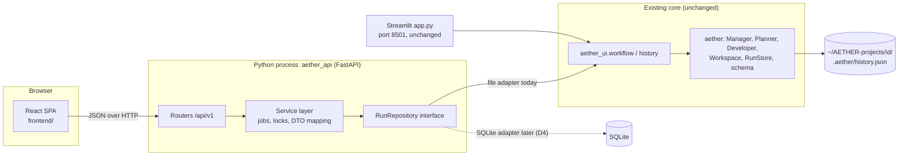
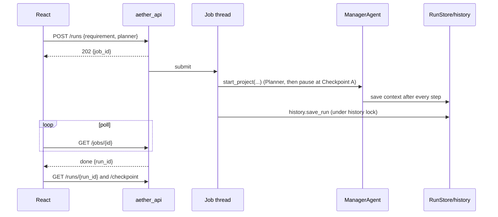
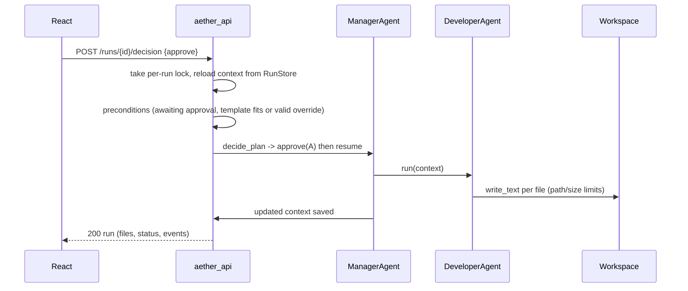

# AETHER React frontend: Phase 1 architecture and implementation plan

Status: ARCHITECTURE APPROVED (owner, 2026-11-25). PHASE 2 IMPLEMENTED (read-only `aether_api`): see section 16 for what was
built, the corrections C1-C12 as applied, deviations from this plan, and Phase 3. Sections 1 to 15 are the approved plan; where
section 16 differs, section 16 describes the code as it is. React, write endpoints, jobs and SQLite are NOT implemented.
Facts below come from reading the repository (marked with file references). Everything under "Proposed" is a recommendation.

---------------------------------------------------------------------------------------------------

## 1. Current architecture assessment

### 1.1 What exists (verified)

| Layer | Files | Role |
|---|---|---|
| Core, UI-free | `aether/` (manager, agents, planner, ollama_planner, fallback, developer, workspace, context, schema, templates, config) | Pipeline, agents, persistence. Only stdlib. No Streamlit import anywhere in `aether/`. |
| UI glue | `aether_ui/workflow.py`, `aether_ui/history.py` | `start_project`, `decide_plan`, `project_agents`, `RunResult`, `progress_steps`, `plan_to_markdown`, history file. **Neither imports Streamlit.** |
| Streamlit-only | `aether_ui/theme.py` (only module importing `streamlit`), `app.py` | Rendering and page flow. `app.py` runs Streamlit calls at import time, so it cannot be imported by an API. |
| CLI | `main.py` | Plan only, via `ManagerAgent.run`. |
| Tests | `tests/` (20 files, 350 tests, stdlib `unittest`) | Core, templates (static + subprocess smoke), Streamlit `AppTest` page tests. |

### 1.2 How a run works today

1. `app.generate()` calls `workflow.start_project(requirement, planner=build_planner(choice), store=RunStore())`.
2. `ManagerAgent.run_pipeline` creates a `ProjectContext` (blackboard), sets `brief`, then `_run_agents`: Planner (`PlannerAgent`), then Developer (`DeveloperAgent`, which has `checkpoint = "A"`).
3. Before the Developer, the Manager records a WAITING event, sets `status = awaiting_approval`, saves, and returns. Agents never mutate the context: they return `AgentResult(updates, notes, attempts)` and the Manager applies them (`_UPDATABLE` whitelist).
4. Approve or reject: `workflow.decide_plan` calls `ManagerAgent.approve` (records `Approval`, rejects set `cancelled`) and then `resume` with `[PlannerAgent, DeveloperAgent]`, skipping agents already DONE. The Developer renders a template through `Workspace.write_text` (path checks, 100 kB per file, 50 files) and returns `FileRecord`s (sha256, size, covered plan steps).
5. Persistence: `~/AETHER-projects/<run_id>/{context.json, events.jsonl, workspace/}` saved after every step (`RunStore.save`, atomic replace). `RunStore` refuses any folder inside AETHER's own folder. History: `.aether/history.json`, 25 newest `RunResult` snapshots, saved by `app.generate` only when a plan exists. Schema versioning: `SCHEMA_VERSION = 1` with `upgrade()`, unknown top-level fields round-tripped (`unknown_fields`).
6. Config: env vars `AETHER_PLANNER`, `AETHER_RUNS_DIR`, `AETHER_HISTORY_FILE`.

### 1.3 What can be reused through an API without changing the core

`start_project`, `decide_plan`, `RunStore.load/list_runs/load_events`, `Workspace.list_files/read_text/resolve`, `developer.preview(context, override)`, `choose_template`/`TemplateChoice`, `progress_steps`, `group_by_phase`, `step_origin`, `plan_to_markdown`, `FEATURE_LABELS`, `history.load_history_report/save_run/entry_to_result/clear_history`, `config.build_planner/planner_setting`, `ollama_planner.ollama_status`.

### 1.4 Findings that shape the design

| # | Finding (evidence) | Consequence |
|---|---|---|
| F1 | Streamlit keeps `result`/`context` in `st.session_state`; the core is otherwise stateless and the context is saved after every step. | An API can be stateless: reload from `RunStore` per request. |
| F2 | UI decisions live in `app.py`, which is not importable: `fit_badge()` labels, "approve disabled when no template or no store", the override acknowledgement checkbox, `display_path()` (hides the user's home path), `EXAMPLES`, and the "save to history after generate" step (`app.py:129-134`). | The API must reproduce these as **server-side rules or fields**, not leave them to JavaScript. Small, listed duplication (see 4.4). |
| F3 | `run_pipeline` creates the `run_id` internally and returns only at a pause or the end. The Ollama planner can block up to 300 s (`OllamaPlanner.timeout`). | Plan generation must be a background job; the client cannot know `run_id` until it finishes. Cancelling a blocked `urllib` call is not possible (same as Streamlit today). |
| F4 | The Manager log (`RunResult.log`) is only stored in history snapshots, not in `context.json`. | The API shows `events` from the context (authoritative) and the log only when a history snapshot exists. |
| F5 | `history.json` is read-modify-write with a fixed temp name and `_read_raw` treats **any** `OSError` as "damaged". `save_run` then copies the file aside and writes only the new entry. On Windows, a read that collides with another process's `replace()` can raise `PermissionError`. | **Data-loss risk when two processes (Streamlit + API) or two API threads write.** Reasoned from code, not reproduced. Mitigation in 9; a core hardening fix is a separate defect task. |
| F6 | A crash mid-run leaves `status = running` forever (saved after "Understand"). | API reports such runs as `stale` when no job owns them. |
| F7 | Generated servers listen on `127.0.0.1:8000` (README). | The AETHER API must not use port 8000. Proposed: API 8765, Vite 5173, Streamlit 8501. |
| F8 | Only `history.json` lists "runs the UI knows about"; `RunStore.list_runs()` lists runs on disk. History entries can have `run_id = None` (invalid runs folder, old entries). | The list endpoint is built from history; detail is by `run_id` when present, else by history entry id. |
| F9 | `README.md` says 155 tests / 10 s; the suite is 350 tests / ~40 s. | Documentation drift only. Not touched. |
| F10 | Tooling on this machine: Node v24.13.1, npm 11.8.0; FastAPI 0.135.3, Starlette 1.0.0, Uvicorn 0.44.0, Pydantic 2.12.5, httpx 0.28.1 installed but **not declared**; `requirements.txt` lists only Streamlit. | Declare API dependencies in a new, separate file. The CLI keeps working on the standard library alone. |
| F11 | Core limits to preserve: runs never inside AETHER's folder, Ollama only on localhost and only `llama3.2:1b`, generated code never run, Workspace path rules. | API adds no execution endpoint and routes every file path through `Workspace.resolve`. |

---------------------------------------------------------------------------------------------------

## 2. Backend options and decision

| Option | Verdict |
|---|---|
| **FastAPI + Uvicorn** | **Recommended.** Typed request/response models (Pydantic v2), automatic OpenAPI, so TypeScript types are generated and cannot drift from the server. The core is synchronous: plain `def` endpoints run in FastAPI's thread pool, so the core needs no async rewrite. Already installed locally. |
| Flask | Works, but no typed contract; types and validation hand-rolled. |
| stdlib `http.server` | Consistent with the project's no-dependency ethos but means hand-writing routing, validation and docs. Not worth it. |
| Streamlit custom component | Does not give an independent React product. |
| Next.js full-stack | SSR/Node server is unnecessary for a local single-user app and would add a second runtime that must call Python anyway. |

Keep the FastAPI layer **thin**: no business rules, only (a) DTO mapping, (b) precondition checks that mirror what Streamlit disables, (c) job management, (d) error mapping. No ORM, no database, no auth provider.

---------------------------------------------------------------------------------------------------

## 3. Proposed target architecture



Principles: one core, two front ends; the API imports `aether` and `aether_ui.workflow/history` only (never `app.py` or `aether_ui.theme`); handlers depend on a `RunRepository` interface so the SQLite migration swaps an adapter, not the API; the API never persists its own DTOs, so `context.json` is only ever written by `RunStore.save`, keeping schema versioning and `unknown_fields` intact.

### Runtime topology
- Dev: Vite dev server on 5173 proxies `/api` to the API on 8765 (same origin to the browser, so no CORS).
- Production-like: `python -m aether_api` serves the API and the built `frontend/dist` from one process on `127.0.0.1:8765`.
- Streamlit keeps running independently on 8501.

---------------------------------------------------------------------------------------------------

## 4. Folder structure and API

### 4.1 Proposed structure (new top-level folders only)

```
aether_api/                     Backend (new; depends on aether and aether_ui.workflow/history)
  __init__.py
  __main__.py                   python -m aether_api  (binds 127.0.0.1)
  app.py                        create_app(): routers, security middleware, static files
  security.py                   Host/Origin checks
  errors.py                     error model and exception mapping
  schemas.py                    Pydantic DTOs (the public contract)
  repository.py                 RunRepository interface + FileRunRepository (RunStore + history)
  jobs.py                       in-memory job registry, thread pool
  locks.py                      per-run and history locks
  routers/                      health.py config.py runs.py files.py history.py
frontend/                       React app (new; isolated)
  package.json  tsconfig.json  vite.config.ts  index.html
  src/
    app/                        providers, router, AppShell
    api/                        generated types + client (openapi-typescript / openapi-fetch)
    features/{workspace,history,settings,about}/
    components/ui/              design-system primitives
    styles/                     tokens.css, base.css
    lib/                        formatting helpers (no business rules)
  tests/                        Vitest + RTL + MSW
  e2e/                          Playwright
docs/react-frontend-plan.md     this file
requirements-api.txt            fastapi, uvicorn (new; requirements.txt untouched)
tests/test_api_*.py             backend tests (unittest + TestClient), same isolation as today
```

### 4.2 Endpoints (`/api/v1`)

| Method and path | Purpose | Maps to |
|---|---|---|
| `GET /health` | Version, schema version, API version | n/a |
| `GET /config` | Planner options and default (`planner_setting()`, falling back to `rule`), model name, limits (requirement max 2000), examples, display-form data locations | `config`, `ollama_planner.DEFAULT_MODEL` |
| `GET /planners/ollama/status` | `{ready, message}`, cached 15 s like the Streamlit cache | `ollama_status` |
| `POST /runs` `{requirement, planner}` | Start planning. Returns `202 {job_id}` | `start_project` + `history.save_run` in a job |
| `GET /jobs/{job_id}` | `running`, `done` (+ `run_id`, `entry_id`), `failed` (+ error) | job registry |
| `GET /history` (C7: was `/runs`) | History list (newest first, max 25) joined with each run's current status, plus `file_state` and `problems` (C6) | `history.load_history_report` + `RunStore.load` |
| `GET /runs/{run_id}` | Full run view: requirement, brief, plan (numbered, phase, origin), progress steps, events, approvals, notes, files, `actions` (see below), load warnings | `RunStore.load`, `progress_steps`, `step_origin` |
| `GET /history/{entry_id}` | Saved snapshot (plan, saved stages, Manager log, run time), with its stored run when that can still be loaded | `history.entry_to_result` |
| `GET /runs/{run_id}/checkpoint?override=` | Checkpoint A preview: template, fit status/evidence/supported/unsupported, planned files with covered steps, uncovered steps, candidates, override consequences | `developer.preview` |
| `POST /runs/{run_id}/approve` and `POST /runs/{run_id}/reject` (SUPERSEDES the single `decision` endpoint; see docs/phase-3-api-write-architecture.md) | Approve (202 + job, optional override with `acknowledged`) or reject (200, synchronous) | `decide_plan` |
| `GET /runs/{run_id}/files` | File records (path, size, sha256, covers, language) | `context.files` |
| `GET /runs/{run_id}/files/content?path=` | Content plus `changed` flag (current sha256 vs recorded) | `Workspace.read_text` |
| `GET /runs/{run_id}/plan.md` | Markdown download | `plan_to_markdown` |
| `DELETE /history` | Clear history (does not delete run folders) | `clear_history` |

Rules:
- **Server-driven actions.** The run DTO carries `actions: {can_approve, can_reject, can_override, disabled_reason}` computed server-side (template present, store valid, status awaiting approval; override needs `acknowledged: true` and a key from `choice.candidates`). React never recomputes fit or eligibility.
- **Paths are query parameters** (`?path=`), never URL segments; everything goes through `Workspace.resolve`. `run_id` must pass `RunStore.run_dir` (`isalnum`). Violations are a 404 or 422, never a stack trace.
- **Short paths only.** Responses carry a `~/AETHER-projects/<id>/workspace` display form (as `display_path` does), never an absolute path with the user name.
- **Error model:** `{"error": {"code": "not_waiting_for_approval", "message": "...", "details": {}}}`. Mapping: `ValueError` from `Manager.approve`/`resume` to 409, `SchemaError` to 422 with the run id, missing run to 404, `OSError` to 503 with a generic message. Paths and tracebacks are never returned.
- **Versioning:** `/api/v1` is a new public contract and is not `context.json`. Additive changes only within v1.

### 4.3 Generation job flow (why jobs)
`POST /runs` validates input, submits `start_project(...)` plus the history save to a small thread pool (2 workers) and returns `202`. The UI polls `GET /jobs/{id}` (300 ms, backing off). For the rule planner it finishes on the first poll; for Ollama the UI shows a long-running state with the same honesty rules as Streamlit ("this can take a few minutes"). Server restart loses jobs but not runs (F6 applies).

### 4.4 Accepted, listed duplication (small, server-side only)
`display_path` (7 lines), `EXAMPLES` list, "save history after a plan exists" (5 lines), "approve disabled when no template" guard. Proposal: put them in `aether_api`; a later, separately approved refactor can move them into a shared module that both front ends import.

---------------------------------------------------------------------------------------------------

## 5. Data flow diagrams

### 5.1 Generate a plan


### 5.2 Approve / reject / override


### 5.3 View a file
`GET files/content?path=` -> `Workspace.resolve` (rejects `..`, absolute, links, bad suffix) -> read -> compare sha256 with `FileRecord` -> `{content, changed}`. Content is rendered as text by React, never as HTML.

---------------------------------------------------------------------------------------------------

## 6. React component hierarchy

```
<App>
  <Providers>  (QueryClient, Router, Theme, Toasts, ErrorBoundary)
  <AppShell>
    <Sidebar>              brand, nav (Workspace, History, Settings, About), collapsible, Ollama status dot
    <TopBar>               run title, status badge, theme toggle (mobile: menu button)
    <Outlet>
      /workspace  and  /workspace/:runId
        <WorkspacePage>
          <RequirementComposer>   ExamplePills, RequirementTextarea (2000 chars), PlannerSelect, GenerateButton
          <RunView runId>
            <ProgressStrip>        Requirement > Plan > Approval > Generated files
            <RunStatusBanner>      success / failure / saved-run notice / AI caution / fallback reason
            <PlanPanel>            PhaseTabs, StepList (origin tags), DownloadPlanButton
            <CheckpointPanel>      FitSummary, PlannedFilesTable, WarningList, DecisionBar, OverrideDialog
            <FilesPanel>           FileExplorer (tree + sizes), CodeViewer (Shiki), ChangedWarning, FileHeader
            <ActivityDrawer>       EventList, TaskBrief/Handoff, ManagerLog (collapsed by default)
      /history   <HistoryPage> HistoryList > HistoryRow, ClearHistoryDialog, EmptyState
      /settings  <SettingsPage> PlannerDefaults (read-only), OllamaStatus, DataLocations (read-only)
      /about     <AboutPage>
Shared: Badge, StatusDot, Button, Dialog, Tabs, Select, Tooltip, Toast, Skeleton, EmptyState, InlineError
```

Layout: left sidebar (256 px, collapses to icons below 1024 px, becomes a drawer on phones). At 1280 px and wider the workspace is two panes (requirement/plan/checkpoint left, files/code right); below that, one column with the same order as Streamlit.

---------------------------------------------------------------------------------------------------

## 7. State management

| Kind | Tool | Notes |
|---|---|---|
| Server state | **TanStack Query** | Keys `['config']`, `['runs']`, `['run', id]`, `['files', id]`, `['file', id, path]`, `['ollama']`. Polling via `refetchInterval` while a job or run is `running`. Mutations invalidate affected keys. |
| Navigation state | **URL** (React Router params and search params) | Selected run, file, tab are deep-linkable. |
| UI preferences | **React Context** persisted to `localStorage` (guarded with try/catch); no Zustand (C12) | Sidebar collapsed, theme. |
| Drafts | component state, mirrored to `sessionStorage` | Requirement draft. |
| Not used | Redux, global stores for server data | The server is the single source of truth; no copy of business state in JS. |

Rule: React displays `actions`, `progress` and `fit` from the API and does not derive them.

---------------------------------------------------------------------------------------------------

## 8. Visual design direction (tokens mirror `aether_ui/theme.py` so both UIs agree)

- Dark first. Background `#09090B`, surface `#111114`, surface-2 `#17171B`, border `#26262B`, text `#EDEDEF`, muted `#8B8B94`, accent `#8B5CF6`, accent text `#A78BFA`, status ok `#34D399`, warn `#FBBF24`, fail `#F87171`. Light theme from the existing `LIGHT` palette, selectable (System, Dark, Light), default Dark.
- Type: Inter for UI, JetBrains Mono for code, **self-hosted** (`@fontsource`) so the app stays offline and sends nothing to third parties. 4 px spacing grid, 8 px radius (matches `baseRadius`), 1 px borders, solid surfaces; at most one subtle accent glow, no gradient backgrounds.
- Motion: 120 to 200 ms opacity/transform only, disabled under `prefers-reduced-motion`. Visible focus rings, WCAG AA contrast, keyboard operable dialogs.
- Honesty rules carried over from Streamlit: statuses come only from the run's real events; "Generated code has not been run" stays visible; AI plans keep their caution.

---------------------------------------------------------------------------------------------------

## 9. Authentication and security

No user accounts exist today (README: single person, one computer); this stays true. Threats on a localhost API are different from a hosted one:

| Risk | Mitigation |
|---|---|
| A website in the user's browser calls `localhost:8765` (CSRF) and approves a plan | No CORS (same origin through the Vite proxy or static serving); mutating requests require `Content-Type: application/json` and a matching `Origin`/`Host`; optional per-launch token header added if needed. |
| DNS rebinding | Host header allow-list (`localhost:8765`, `127.0.0.1:8765`); bind only to `127.0.0.1`. |
| Path traversal / symlink escape | Only `Workspace.resolve`; `run_id` validated by `RunStore.run_dir`; paths by query parameter. |
| Code execution | No endpoint runs generated code (D2 Docker sandbox is a separate, later decision). |
| XSS from generated code or requirement text | React escapes by default; no `dangerouslySetInnerHTML`; Shiki output is produced from tokens, not from raw input. |
| Information leak | Short `~/...` paths, generic error messages, no tracebacks, no secrets exist or are handled. |
| Resource abuse | `max_length=2000` enforced server-side, request size cap, 2-worker job pool, per-run lock. |
| Future multi-user or cloud | Out of scope. It would need real authentication (for example OIDC), per-user run folders and a database (D4). Unguessable run ids are not authentication. |

---------------------------------------------------------------------------------------------------

## 10. Integration risks and mitigations

| Risk | Likelihood / impact | Mitigation |
|---|---|---|
| R1 history/run file races between Streamlit and the API, and the destructive "damaged" path (F5) | Medium / High (data loss) | API serialises history writes (lock) and saves per run under a per-run lock; run Streamlit and API together only for read-mostly checks; propose a separate defect task: treat `PermissionError` as retryable and never rewrite history when the read failed for a non-parse reason. |
| R2 blocking Ollama call and no run_id until finish (F3) | High / Medium | Job registry now; optional additive core hook later (`on_context` callback) for live progress. |
| R3 contract drift between Python and TypeScript | Medium / Medium | OpenAPI-generated types; committed OpenAPI snapshot test fails on unreviewed change. |
| R4 UI rules scattered in `app.py` (F2) | Certain / Medium | Server computes `actions` and `fit`; duplication listed in 4.4 and removable by a later shared-module refactor. |
| R5 stale `running` runs (F6) | Low / Low | Report as `stale` when no active job. |
| R6 port clash with generated apps (F7) | Medium / Low | API 8765, documented. |
| R7 SQLite migration later | Certain / Medium | Repository interface, `run_id` as canonical id, DTOs separate from storage. |
| R8 test-suite timing flakiness on a sleeping machine (K40) | Medium / Low | Do not leave full-suite runs unattended on a laptop that sleeps; API tests use no long waits. |
| R9 scope creep (parity is large) | High / Medium | Strict phases with exit criteria; Streamlit stays until the parity checklist passes (D3). |
| R10 dependency weight/supply chain | Medium / Low | Few, mainstream dependencies; lockfile committed; `npm audit` and `pip-audit` in the checklist. |

---------------------------------------------------------------------------------------------------

## 11. Phased roadmap (each phase ends with: full existing suite passes, Streamlit unchanged, owner review)

| Phase | Scope | Exit criteria | Relative effort |
|---|---|---|---|
| 2 (DONE, Task 012) | `aether_api` foundation: `create_app`, security middleware, error model, `health`, `config`, read-only `runs`, `history/{id}`, `files`. `requirements-api.txt`. Backend tests. **No React.** | Endpoints return correct data from temporary stores; traversal and Host tests pass; OpenAPI snapshot committed. | M (3 to 4 days) |
| 3 | Write paths: `POST /runs` job flow, checkpoint preview, `decision` (approve, reject, override), locks, plan download, clear history. | Behavioural parity with `app.py` flows including failure cases (K35, K36, K38, K39 documented); concurrency tests. | M/L (4 to 5 days) |
| 4 | Frontend scaffold: Vite, TypeScript strict, tokens, AppShell, generated client, health page, lint/test setup. | Builds; Vitest runs; no Streamlit change. | S/M (2 to 3 days) |
| 5 | Workspace vertical slice: composer, progress strip, plan panel, checkpoint, approve/reject/override, files and code preview. | One run end-to-end in the browser against the real API (rule planner). | L (8 to 10 days) |
| 6 | History and run detail, activity drawer, Ollama status/selection, error and empty states. | Parity for History page behaviours covered by `test_history_page.py`. | M (4 to 5 days) |
| 7 | Settings, About, responsive pass, accessibility, motion polish, Playwright e2e. | axe has no serious violations; mobile and desktop screenshots reviewed. | M (4 to 5 days) |
| 8 | Packaging (`python -m aether_api` serves the build), docs, parity audit against Streamlit. | Written parity checklist signed by the owner; then decide Streamlit's future (D3). | S/M (3 to 4 days) |

Effort is a rough single-developer relative estimate (about 28 to 36 working days in total), not a commitment.

---------------------------------------------------------------------------------------------------

## 12. Testing strategy

- **Existing 350 tests are untouched** and run at the end of every phase.
- **Backend:** `unittest` (same framework) with FastAPI `TestClient` (httpx is installed), skipped cleanly if FastAPI is missing, mirroring the Streamlit skip. Same isolation: temporary `AETHER_RUNS_DIR`/`AETHER_HISTORY_FILE`, `urllib.request.urlopen` blocked, no real user data. Cases: every endpoint, each error mapping, traversal and symlink attempts, Host/Origin rules, double-approve race, damaged history/context files, schema-version fixtures, OpenAPI snapshot, parity checks against `progress_steps`/`preview` outputs.
- **Frontend:** TypeScript strict and ESLint; Vitest + React Testing Library for components; MSW for API mocks; Playwright end-to-end against a real API using temporary data and the rule planner; axe accessibility checks; Ollama never required.
- **Parity matrix:** each behaviour asserted by `test_history_page.py`, `test_workspace_page.py`, `test_app_error_paths.py` and `test_checkpoint_ui.py` gets an API test or an e2e test.
- **CI** does not exist today; adding GitHub Actions is a decision (D8).

---------------------------------------------------------------------------------------------------

## 13. Technology choices and why

| Technology | Why it is appropriate |
|---|---|
| FastAPI, Uvicorn, Pydantic v2 | Typed contract and OpenAPI; sync endpoints suit the synchronous core; installed already. |
| React + TypeScript (strict) | The requested frontend; types catch contract drift. |
| Vite | Static build, fast dev server, proxy; no SSR needed for a local app. (Next.js and Create React App rejected.) |
| React Router | Deep-linkable runs, files and tabs. |
| TanStack Query | Polling, caching, invalidation for server state, which is nearly all of this app's state. |
| React Context + `localStorage` | Two or three UI preferences need no extra dependency (Zustand dropped, C12). Pin React and Tailwind versions in Phase 4. |
| Tailwind CSS with CSS-variable tokens | Fast, consistent spacing and theming; tokens map one-to-one to `theme.py`. |
| Radix UI primitives, shadcn-style copied components | Accessible dialogs, tabs and selects without a locked-in component library. |
| lucide-react | Consistent, small icon set. |
| Shiki (lazy-loaded) | High-quality, read-only code highlighting. |
| @fontsource Inter and JetBrains Mono | Offline fonts, no third-party requests. |
| openapi-typescript + openapi-fetch | Generated types and client from the server contract. |
| Vitest, RTL, MSW, Playwright, axe | Component, integration, e2e and accessibility testing. |
| npm | Already installed (11.8.0); no extra package manager. |

Dependencies between phases: 2 before 3; 3 before 5; 4 can run in parallel with 3; 5 needs 3 and 4; 6 and 7 need 5; 8 needs all.

---------------------------------------------------------------------------------------------------

## 14. Decisions requiring owner approval

1. **Backend:** FastAPI as a thin layer in new package `aether_api/`, API port 8765.
2. **Layout:** new top-level `aether_api/` and `frontend/`; dependencies in new `requirements-api.txt` and `frontend/package.json`; `requirements.txt` unchanged.
3. **Async model:** background jobs with polling (recommended) versus one long synchronous request.
4. **Core changes:** none in Phases 2 and 3 (recommended). Separately: do you want a defect task for history hardening (R1), and later the optional `on_context` hook (R2)?
5. **Duplicated UI rules (4.4):** accept in `aether_api` for now, with a later shared-module refactor?
6. **Serving:** one process serving the built UI in production, Vite proxy in development.
7. **Security level:** Host/Origin checks and same-origin only (recommended) versus adding a per-launch token from the start.
8. **CI:** whether to add GitHub Actions in a later phase.
9. **Process:** this plan lives in new file `docs/react-frontend-plan.md`; may `AETHER_DEVELOPMENT_LOG.txt` be refreshed for planning tasks, or only for implementation tasks? (It was not touched.)
10. **Branding and design:** confirm default theme Dark, light theme kept, Inter + JetBrains Mono.

## 15. Next implementation task

Phase 2 (Task 012) is done: see section 16. Task 013 (history persistence hardening) is done too (16.7). The next task is Phase 3, Task 014, described at the end of section 16.

---------------------------------------------------------------------------------------------------

## 16. Phase 2 as built (Task 012, read-only API) and Phase 3

### 16.1 Approved decisions (owner)
FastAPI in `aether_api/`, API port 8765, Vite 5173 later, separate `frontend/` and `requirements-api.txt`; background jobs
with polling for planning in a later phase; Host/Origin validation with localhost binding and no per-launch token for now;
Streamlit stays fully operational; the core is reused without duplication; React Context + `localStorage` for preferences
(no Zustand) and TanStack Query for server state in Phase 4.

### 16.2 What exists now
```
aether_api/
  __init__.py        constants: API_VERSION, API_PREFIX /api/v1, BIND_HOST 127.0.0.1, DEFAULT_PORT 8765, DEV_PORT 5173
  __main__.py        python -m aether_api [--port N] [--dev] [--dump-openapi]   (there is no --host option)
  app.py             create_app(settings, repository): routers, error handlers, LocalhostGuard (outermost)
  security.py        SecuritySettings + LocalhostGuard (pure ASGI middleware)
  errors.py          one error shape, domain-error -> HTTP mapping
  schemas.py         every response model (the contract); no request bodies exist yet
  repository.py      RunRepository interface + FileRunRepository (RunStore, aether_ui.history, Workspace); retry on PermissionError
  presenters.py      core objects -> response models; scrub(); the small DUPLICATED presentation rules
  deps.py            get_repository
  routers/           health, config, history, runs, files
requirements-api.txt fastapi>=0.135.3,<0.136; uvicorn>=0.44.0,<0.45; httpx>=0.28.1,<0.29
tests/api_support.py + tests/test_api_{basic,contract,errors,files,history,runs,security,side_effects}.py   144 tests
```
Endpoints (all GET, under `/api/v1`): `health`, `config`, `planners/ollama/status`, `history`, `history/{entry_id}`,
`runs/{run_id}`, `runs/{run_id}/checkpoint[?override=]`, `runs/{run_id}/files`, `runs/{run_id}/files/content?path=`,
`runs/{run_id}/plan.md`, plus `openapi.json`. Not implemented on purpose: `POST /runs`, `GET /jobs/{id}`,
`POST /runs/{id}/approve`, `POST /runs/{id}/reject`, `DELETE /history`, or any other write.

### 16.3 Deviations from sections 1 to 15 (and why)
- `presenters.py` and `deps.py` were added; `jobs.py` and `locks.py` were NOT created: a read-only API needs no job registry or
  locks (C10: "only if necessary"). They arrive in Phase 3 with the first write.
- `/runs` has no list endpoint: the list is `/history` (C7).
- The run response is one model, `RunView`, for a stored run (`source: "run"`) and a history snapshot (`source: "snapshot"`).
- `actions` describes ELIGIBILITY only (can_approve, can_reject, can_override, disabled_reason); the decision endpoint is Phase 3.
- `stale` runs are not reported yet: with no jobs, "no active job" cannot be told apart from a run another process is executing.
- The history file state is checked by `FileRunRepository._probe_history` (read, retry, parse) before the core's own
  `load_history_report`, because the core treats an unreadable or damaged file as an empty history (K36) and cannot say which.
- OpenAPI docs pages (`/docs`, `/redoc`) are disabled (they load scripts from a CDN); the contract is `/api/v1/openapi.json`.

### 16.4 Corrections as applied
| # | Applied how |
|---|---|
| C1 | Every file route calls `repository.load_run()` first (404/422/503 before anything else). A `Workspace` is built only for a run with recorded files whose workspace folder already exists; listing, viewing a run, the checkpoint and `plan.md` never build one. Tests count constructions and compare whole directory trees (sizes and mtimes) before and after. |
| C2 | `LocalhostGuard`: Host allow-list (`localhost:PORT`, `127.0.0.1:PORT`, plus `:5173` only with `--dev`); an Origin that is present must be in the allow-list on every method; every non-GET needs an allowed Origin (even bodyless) and then gets 405; no CORS headers; websockets refused. Vite's proxy must use `changeOrigin: true` (Phase 4). |
| C3 | `tests/api_support.py` raises ImportError (naming `requirements-api.txt`) if FastAPI, httpx or uvicorn is missing; each API test module re-raises it. A child-process test proves the guard raises. Final runs show a plain `OK` with no `skipped=`. |
| C4 | `RunView` carries `ok`, `error`, `error_details`, `developer_error`, `fallback_reason` (context notes, else the history snapshot), `actions.disabled_reason`, `context_state`. An invalid runs folder gives a persistent reason (same on every request) and `GET /config` a `runs_folder_invalid` warning; run endpoints answer 503 `runs_folder_invalid`. |
| C5 | `schemas.py` (Pydantic v2), documented errors on every operation, unique operation ids, OpenAPI 3.1 via `--dump-openapi`. |
| C6 | `HistoryResponse.file_state` (`ok`, `missing`, `damaged`, `unreadable`) and `problems[]` from `load_history_report`; each entry has `context_state` (`ok`, `missing`, `unreadable`). Reading never rewrites or copies history aside. |
| C7 | `/history` and `/history/{entry_id}` for history; `/runs/{run_id}...` for stored runs. |
| C8 | `synthesize_result()` builds a minimal `RunResult` for `progress_steps`; run time and the Manager log appear only when a history snapshot exists; timestamps are the core's naive local ISO strings, unchanged. |
| C9 | `{"error": {"code", "message", "details"}}`; 404, 422, 503 (and 403/405 from the guard); domain failures (failed or cancelled run, Developer failure) are 200 run state; unexpected exceptions are a generic 500; text from saved data is scrubbed of the home folder and AETHER's folder. |
| C10 | `retry_read()` (3 attempts, 50 ms) on `PermissionError` for context, history and file reads; a failed history read is never turned into a rewrite. Core persistence is unchanged. |
| C11 | `.gitignore` (`node_modules/`, `frontend/dist/`), `.claude/launch.json` entry `aether-api` (that file is itself git-ignored), README section, pinned ranges in `requirements-api.txt`. |
| C12 | Recorded in sections 7 and 13. |

### 16.5 Findings from the implementation (core behaviour, NOT changed)
1. **The planner fallback reason is not stored in the run.** `start_project` wraps the planner in a `TracingPlanner`, which hides
   `fallback_reason` from `PlannerAgent`, so a run created through either UI has no `notes["planner_fallback"]` and no failed
   "Build plan with local AI model" event. Only the history snapshot has the reason. The API reads the note first and falls back to
   the snapshot; a test pins the current behaviour. Candidate core fix: expose `fallback_reason` on `TracingPlanner`.
2. **Reading history through the core cannot tell "damaged" from "empty"** (K36), and `save_run` rewrites after any read `OSError`
   (R1). The API avoids both for reads; the write-side hardening is a Phase 3 prerequisite (decision needed).
3. A partial Developer failure (K38) is shown by the API as `developer_error`; Streamlit still shows no message.

### 16.6 Known limitations
Read-only; no jobs; eligibility flags without a decision endpoint; `workspace_exists` and `is_file` are stat checks, so a file
replaced between the check and the read yields a normal `missing` or error response; symlink escape is covered by the existing
`Workspace.resolve` tests, not re-tested through the API (creating symlinks needs privileges on Windows); the API reads at most
25 history entries and one run per entry for the list; Ollama status makes one local request (cached 15 s); a run left in status
`running` is shown as it is saved.

### 16.7 Task 013 (done): history persistence hardening, the Phase 3 prerequisite
R1 is resolved in the core. `aether/fileio.py` provides an atomic write (unique temp file, fsync, `os.replace` with retry), a
retrying read and a cross-process, cross-thread lock; `aether_ui/history.py` now saves and clears under that lock
(`history.json.lock`), reads strictly before changing anything (a read failure raises `HistoryReadError`, an OSError, and
writes nothing; only a file that was read and is really corrupt is copied aside, then replaced), and raises typed
`HistoryError`s (`HistoryReadError`, `HistoryLockError`, `HistoryWriteError`) that Phase 3 can map to 503. `RunStore` uses the
same atomic write (no lock; Phase 3 adds per-run locks). Reads stay lock-free and the API is unchanged; Streamlit still shows a
damaged or unreadable file as an empty history (K36, by decision). Details are in the development log.

### 16.8 Phase 3 (next, Task 014): the write path
**The detailed, current design is `docs/phase-3-api-write-architecture.md` (Task 014.1).** It supersedes the summary below where
they differ: `POST .../decision` is split into `/approve` (202 + job) and `/reject` (200); run id and progress come from an
`ObservedRunStore` (no core change); per-run locks live under `<runs folder>/.locks/`.

Scope: `POST /api/v1/runs` (202 + job), `GET /api/v1/jobs/{id}`, `POST /api/v1/runs/{id}/decision` (approve, reject, override with
`acknowledged`), `DELETE /api/v1/history`; bounded in-memory job registry (TTL, size cap, one Ollama job at a time); per-run and
history locks; `jobs.py` and `locks.py`; request schemas; 409 `not_waiting_for_approval`; the template guard (no template and
no valid override is a 409, not a recorded Developer failure); history save after a plan exists (the `app.generate` rule); the
Origin check already enforces same-origin writes (allow POST/DELETE for allowed origins and keep 405 for everything else);
`stale` run reporting; parity tests against the Streamlit flows. Prerequisites needing owner decisions: (a) a defect task for
history write hardening (DONE in Task 013, see 16.7), (b) whether to fix the
TracingPlanner fallback note (finding 1) in the core, (c) whether `GET /jobs/{id}` should also expose live progress, which needs the
optional core hook for an early `run_id` (R2).
